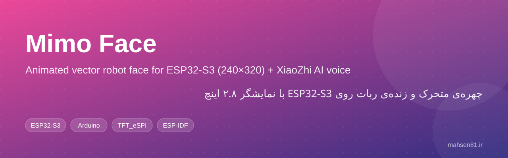
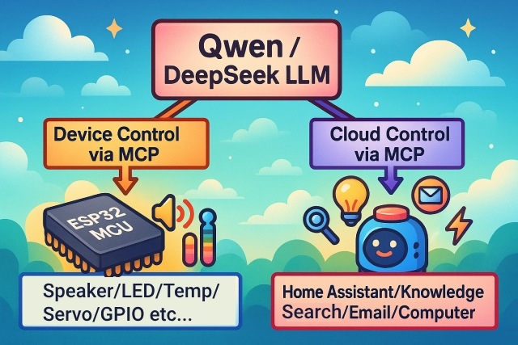

<!-- gen:header -->
<p align="center"></p>

<h1 align="center">Mimo Face</h1>
<p align="center"><b>چهره‌ی متحرک و زنده‌ی ربات روی ESP32-S3 با نمایشگر ۲.۸ اینچ</b><br><i>Animated vector robot face for ESP32-S3 (240×320) + XiaoZhi AI voice</i></p>
<p align="center">   </p>

<div dir="rtl">

## ✨ امکانات

- چشم‌هایی که نگاه می‌چرخانند و خودکار پلک می‌زنند
- رسم برداری؛ بدون نیاز به کارت حافظه
- تنظیمات آماده برای برد ES3C28P
- همراه با فریم‌ور دستیار صوتی XiaoZhi (MCP)

</div>

## 📸 تصاویر · Screenshots

<p align="center"> </p>

## 🚀 Quick start

```bash
Arduino IDE → install esp32 + TFT_eSPI → open MimoFace_src/MimoFace/MimoFace.ino → Upload
```

---

<p align="center">ساخته‌شده توسط <a href="https://mahsen81.ir"><b>محسن جباره‌اصل</b></a> — برنامه‌نویسی، طراحی سایت، ربات و هوش مصنوعی<br>
Built by <a href="https://mahsen81.ir">Mohsen Jabbareh-Asl</a> · ⭐ اگر مفید بود، ستاره بدهید · Need a custom version? <a href="https://mahsen81.ir">Get in touch</a></p>
